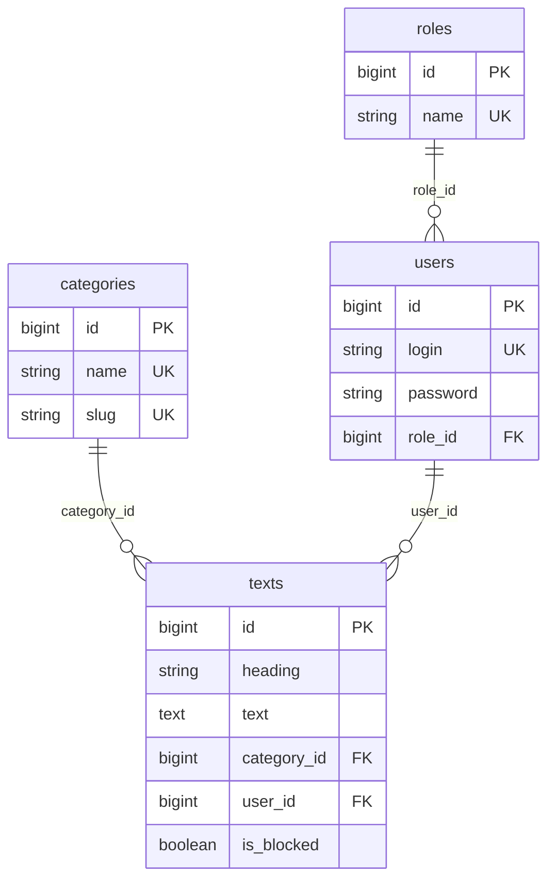

# ТехноВзгляд

Учебный новостной портал о науке и технологиях на **Laravel 13** и **PostgreSQL**.
Проект объединяет четыре лабораторные работы: вёрстку, проектирование базы данных,
разграничение прав по ролям и CRUD-панели журналиста и администратора.

## Стек

- **PHP 8.3+**, Laravel 13
- **PostgreSQL 17** (управление через pgAdmin 4)
- Blade-шаблоны, отдельная таблица стилей `public/css/style.css`
- PHPUnit (15 тестов)

## Возможности

- Главная страница с лентой опубликованных статей и пагинацией.
- Каталог категорий и страница статей выбранной категории.
- Полная страница статьи с автором, категорией и датой.
- Регистрация по уникальному логину, вход и выход.
- Личный кабинет журналиста: создание, редактирование и удаление своих статей.
- Админ-панель: сводка, редактирование и удаление статей,
  блокировка/разблокировка, смена роли пользователей.
- Блокировка статей (`is_blocked`): заблокированный материал скрыт от читателей.
- Простая адаптивная вёрстка и страница 403.

## Роли и доступ

| Раздел | Гость | Читатель | Журналист | Администратор |
|---|:---:|:---:|:---:|:---:|
| Главная, категории, статьи | ✅ | ✅ | ✅ | ✅ |
| Вход и регистрация | ✅ | — | — | — |
| Кабинет журналиста | — | — | ✅ | ✅ |
| Админ-панель | — | — | — | ✅ |

Доступ проверяется middleware `auth` и `role` (`app/Http/Middleware/EnsureUserHasRole.php`).
Журналист может редактировать только собственные статьи; администратор — любые.

## Демо-аккаунты

| Логин | Пароль | Роль |
|---|---|---|
| `admin` | `admin12345` | Администратор |
| `journalist` | `journalist123` | Журналист |
| `reader` | `reader12345` | Читатель |

Пароли хранятся в базе только в виде bcrypt-хеша.

## Структура базы данных



Ограничения целостности:

- `users.role_id` → `roles.id`, удаление роли запрещено (`RESTRICT`).
- `texts.category_id` → `categories.id`, удаление категории со статьями запрещено.
- `texts.user_id` → `users.id`, при удалении автора удаляются его статьи (`CASCADE`).
- Уникальные поля: `roles.name`, `categories.name`, `categories.slug`, `users.login`.
- Индекс `(is_blocked, created_at)` ускоряет вывод ленты.

## Установка

### 1. Требования

- PHP 8.3+ с расширениями `pdo_pgsql`, `pgsql`, `mbstring`, `openssl`
- Composer
- PostgreSQL 17 и pgAdmin 4

### 2. База данных

Создайте базу в pgAdmin 4 или через `psql`:

```sql
CREATE DATABASE news_site;
CREATE DATABASE news_site_testing; -- для запуска тестов
```

Скопируйте `.env.example` в `.env` и укажите параметры подключения:

```dotenv
DB_CONNECTION=pgsql
DB_HOST=127.0.0.1
DB_PORT=5432
DB_DATABASE=news_site
DB_USERNAME=postgres
DB_PASSWORD=postgres
```

### 3. Проект

```bash
composer install
cp .env.example .env        # Windows: copy .env.example .env
php artisan key:generate
php artisan migrate --seed
php artisan serve
```

Сайт откроется по адресу <http://127.0.0.1:8000>.

Команда `php artisan migrate --seed` создаёт таблицы, роли, категории,
демо-пользователей и девять демонстрационных статей.

## Локальный портативный PostgreSQL

На текущей машине PostgreSQL 17 установлен без прав администратора в
`%LOCALAPPDATA%\pgsql`, поэтому сервер нужно запускать вручную:

```powershell
.\scripts\postgres-start.ps1   # запуск
.\scripts\postgres-stop.ps1    # остановка
```

Подключение в pgAdmin 4:

| Параметр | Значение |
|---|---|
| Host | `127.0.0.1` |
| Port | `5432` |
| Maintenance database | `postgres` |
| Username | `postgres` |
| Password | `postgres` |

## Комментарии в коде

- `public/css/style.css` — комментарий к каждому свойству.
- Blade-шаблоны — пояснение `{{-- ... --}}` перед каждой значимой строкой.
- PHP-контроллеры, модели, миграции и сидеры — построчные комментарии `//`.

## Тесты

```bash
php artisan test
```

Тесты используют отдельную базу `news_site_testing` (параметры заданы в `phpunit.xml`),
поэтому рабочая база `news_site` не затрагивается. Перед запуском PostgreSQL должен
быть запущен.

## Лабораторные работы

1. **Вёрстка.** Общий каркас `layouts/app.blade.php`, переиспользуемые компоненты
   `x-site.header` и `x-site.footer` на каждой странице, простая адаптивная вёрстка,
   отдельный файл стилей `public/css/style.css` с построчными комментариями.
2. **База данных.** Четыре таблицы (`roles`, `categories`, `users`, `texts`),
   внешние ключи, уникальные ограничения и каскадные правила; миграции и сидеры.
3. **Роли и связи.** Роли `admin`, `journalist`, `user`, middleware `role`,
   связи Eloquent `belongsTo` / `hasMany`, ограничение доступа к разделам.
4. **CRUD.** Журналист создаёт и редактирует статьи; администратор управляет
   статьями и пользователями, блокирует материалы и меняет роли.

## Структура проекта

```text
app/
  Http/Controllers/          # публичные, авторизация, журналист, админ
  Http/Middleware/           # проверка роли
  Http/Requests/             # валидация форм
  Models/                    # Role, Category, User, Text
database/
  migrations/                # схема БД
  seeders/                   # роли, категории, пользователи, статьи
public/css/style.css         # стили с комментариями к каждой строке
resources/views/
  components/site/           # header и footer
  layouts/app.blade.php      # общий каркас
  ...                        # страницы разделов
routes/web.php               # маршруты и middleware
tests/Feature/SiteTest.php   # функциональные тесты
scripts/                     # запуск локального PostgreSQL
```

## Безопасность

- Пароли хешируются через bcrypt (`casts` в модели `User`).
- Все формы защищены CSRF-токеном Laravel.
- Данные проверяются Form Request-классами.
- Blade экранирует вывод, SQL-запросы строятся через Eloquent.
- Закрытые разделы защищены middleware, а не только скрытием ссылок в меню.

## Лицензия

Учебный проект. Код распространяется по лицензии MIT.
